# Examples

All example scripts live in [`examples/standalone/`](https://github.com/JuliaGeodynamics/DRex.jl/tree/main/examples/standalone) and reproduce figures from Bilton et al. (2025) for D-Rex, and from Ribe, Faccenda & VanderBeek (2026) for ODFTEX (see [ODFTEX paper figures](@ref) below). They require `CairoMakie` for plotting, which is available through the bundled project environment:

```bash
cd examples/standalone
julia --project=. -t auto <script>.jl
```

The `-t auto` flag activates all available CPU cores.

---

## Figure 4 — Single-crystal a-axis / FSE misfit (`fig4_simple_shear_lag.jl`)

Theoretical and numerical misfit between the olivine [100] a-axis angle θ and the finite strain ellipsoid (FSE) long-axis angle Φ in simple shear, as a function of accumulated strain ε.

Demonstrates:
- Analytical predictions (eqs. 24 and 29 of the paper) vs. DRex with 1 grain and M\*=0
- Use of [`finite_strain`](@ref) and [`smallest_angle`](@ref)

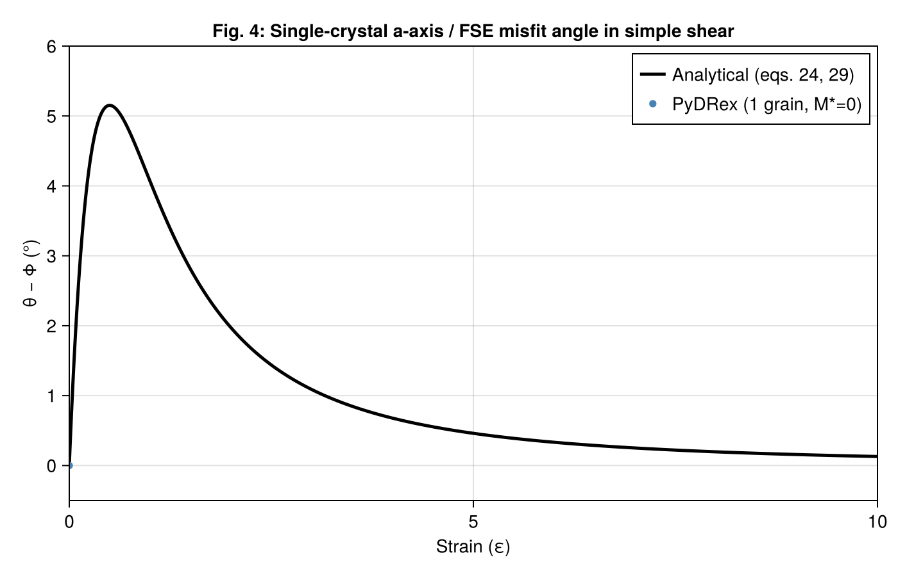

---

## Figure 5 — Single-crystal rotation rates (`fig5_rotation_rates.jl`)

Numerical rotation rates for a single A-type olivine crystal in simple shear, as a function of the initial [100] angle from the shear direction. Compared to the theoretical relationship (eq. 23 of the paper).

Demonstrates:
- Single-grain simulations with fixed initial orientation

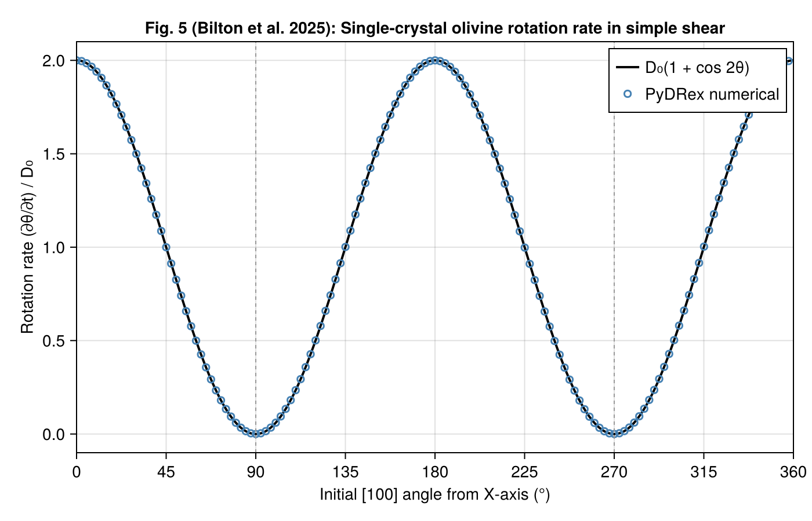

---

## Figure 7 — Polycrystal rotation and growth rates (`fig7_recrystallisation.jl`)

Rotation rates (a) and grain growth rates (b) for an A-type olivine polycrystal with an ideal girdle texture in the X–Y plane, deforming in simple shear.

Demonstrates:
- Use of [`derivatives!`](@ref) directly on a polycrystal

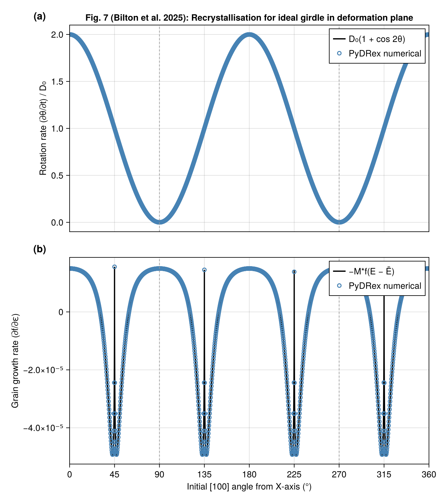

---

## Figure 8 — Effect of M\* on CPO direction in simple shear (`fig8_simple_shear_GBM.jl`)

CPO direction (from the hexagonal symmetry axis of the Voigt-averaged elastic tensor) vs. accumulated strain, for several values of the grain boundary mobility M\*. Ensemble of multiple random seeds; mean ± 1 std. dev. plotted.

Demonstrates:
- Effect of `gbm_mobility` on CPO evolution
- [`voigt_averages`](@ref) and [`elasticity_components`](@ref)

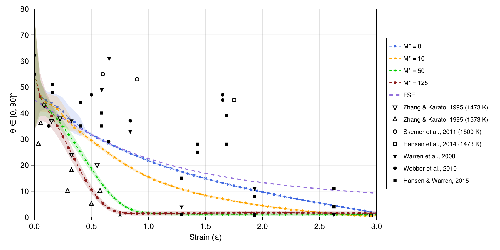

---

## Figure 9 — [100] pole figures (`fig9_pole_figures.jl`)

[100] pole figures (Lambert equal-area projections) for A-type olivine in simple shear at four strain values and three M\* values (0, 50, 200).

Demonstrates:
- [`poles`](@ref) and [`lambert_equal_area`](@ref)
- [`resample_orientations`](@ref)

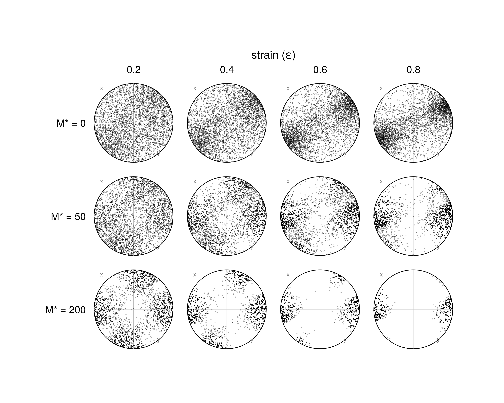

---

## Figure 10 — Corner flow CPO (`cornerflow_simple.jl`)

CPO evolution along four pathlines in an analytical 2D corner flow, for M\*=10 and M\*=125 (Fig. 10 of the paper). Panels show Bingham-average fast axis directions (scaled by M-index) and M-index vs. strain curves.

Reproduces the main benchmark figure used to validate the Julia implementation.

```bash
julia --project=. -t auto cornerflow_simple.jl          # CPU, Float64 + Float32
julia --project=. cornerflow_simple.jl --metal           # Metal GPU (Apple Silicon)
julia --project=. -t auto cornerflow_simple.jl --batch   # CPU batch integrator
```

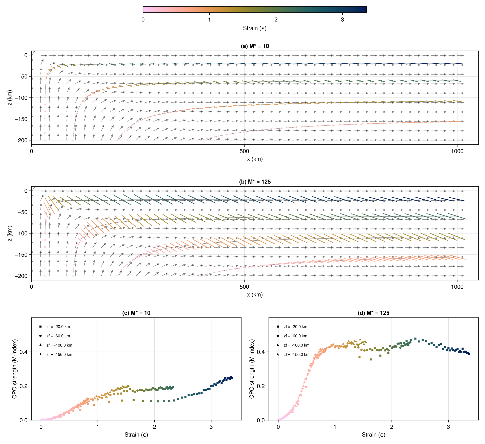

---

## ODFTEX paper figures

The `odftex_fig*.jl` scripts reproduce the model figures of Ribe, Faccenda & VanderBeek (2026, GJI) with the continuum ODFTEX texture model. Figures 3–7 follow a single deformation path at high Euler-space resolution; Figure 8 evolves 9600 aggregates along pathlines of a 2-D flow and compares ODFTEX with D-Rex. Each entry ends with a note on how the result compares with the paper. Figures 9 and 10 of the paper (3-D subduction with SKS splitting) are not reproduced; the [LaMEM comparison](@ref "Choosing the texture model: D-Rex or ODFTEX") is the closest equivalent.

The solver itself is checked element by element against the authors' Fortran code in the test suite, so the differences noted below come from resolution, from how a diagnostic is defined, or from inputs the paper does not specify.

### Figure 3 — Pure shear (`odftex_fig3_pureshear.jl`)

Olivine pole figures after pure shear to a strain of 0.7, without recrystallisation (λ = 0) and with it (λ = 2.6).

**Compared with the paper:** the pole figures match, on the paper's 0–3.5 colour scale. Without recrystallisation the [001] distribution is uniform (peak 1.03 multiples of uniform density, MUD), which the paper shows is an exact result. With λ = 2.6 the three effects the paper describes all appear: the texture is stronger ([100] peak 3.57 against 2.75 MUD), [001] becomes anisotropic, and the [100] and [010] peaks split in two.

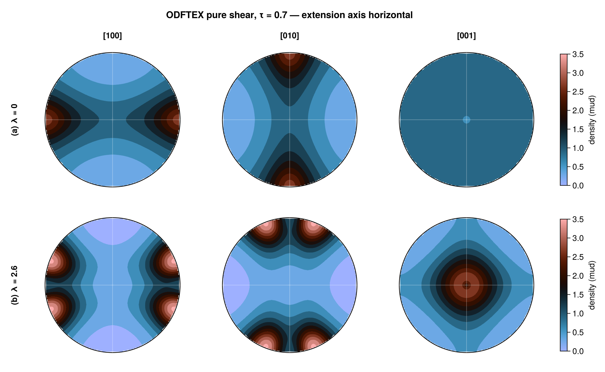

### Figure 4 — Simple shear without recrystallisation (`odftex_fig4_simpleshear.jl`)

Olivine pole figures after simple shear to 100 % and 200 % strain with λ = 0. White lines mark the long axis of the finite strain ellipsoid (FSE).

**Compared with the paper:** the pole figures match. As in the paper, the [100] peak lies on the FSE long axis at both strains (31.7° and 22.5° from the shear plane) and [001] stays uniform. The [100] peak reaches 2.0 and 3.5 MUD, consistent with the paper's 0–3.5 colour scale.

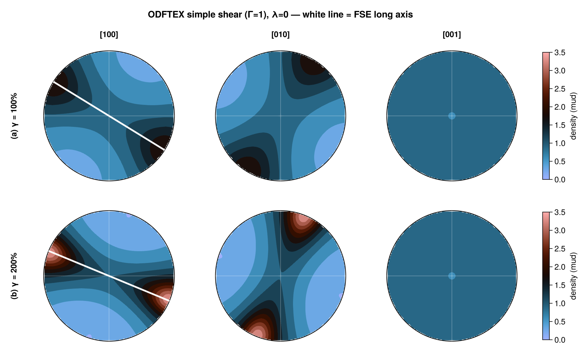

### Figure 5 — Simple shear to 140 % strain (`odftex_fig5_mit23.jl`)

Model panel for the MIT23 experiment (λ = 2.6). Lines on the [100] panel: shear plane (black), maximum instantaneous extension (yellow), long axis of the finite strain ellipsoid (red).

**Compared with the paper:** the pattern matches panel (b) of the paper: [100] peaks close to the shear plane, a [010] maximum normal to it, and a [001] maximum in the centre that is absent without recrystallisation. Texture strength agrees to within 10 %:

| Euler boxes | M-index, paper | M-index, DRex.jl |
|---|---|---|
| 12³ | 0.115 | 0.122–0.126 |
| 60³ | 0.133 | 0.127–0.129 |

The range is over three random samples: the M-index here is estimated from 40 000 orientations drawn from the ODF, and the paper does not say how its value is computed. The experimental panel (a) is not reproduced.

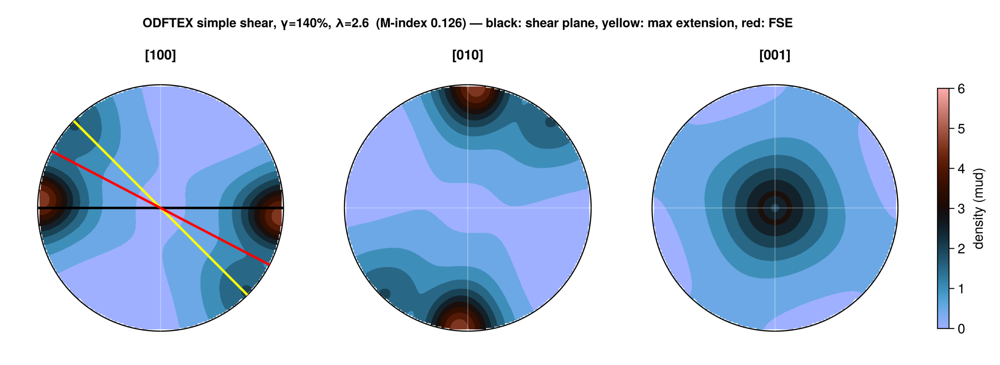

### Figure 6 — [100] orientation versus shear strain (`odftex_fig6_orientation_vs_strain.jl`)

Mean orientation of the olivine [100] axis relative to the shear plane in simple shear, for λ = 2.6 and λ = 10, together with the FSE long axis.

**Compared with the paper:** the curves agree to within about 3°. For λ = 2.6 the mean [100] axis is 24° from the shear plane at a shear strain of 1 and 6° at a strain of 2 (paper: about 27° and 6°), far ahead of the FSE (22.5° at a strain of 2). For λ = 10 it reaches the shear plane by a strain of about 1.3, as in the paper. One detail differs: in the paper the λ = 2.6 curve stays slightly above the FSE up to a strain of about 0.65, whereas here it is 2° below it at a strain of 0.5. The paper does not define its "expectation value" of the orientation; the leading eigenvector of the [100] orientation tensor ([`odf_mean_axis`](@ref)) is used here. The laboratory data points are not shown.

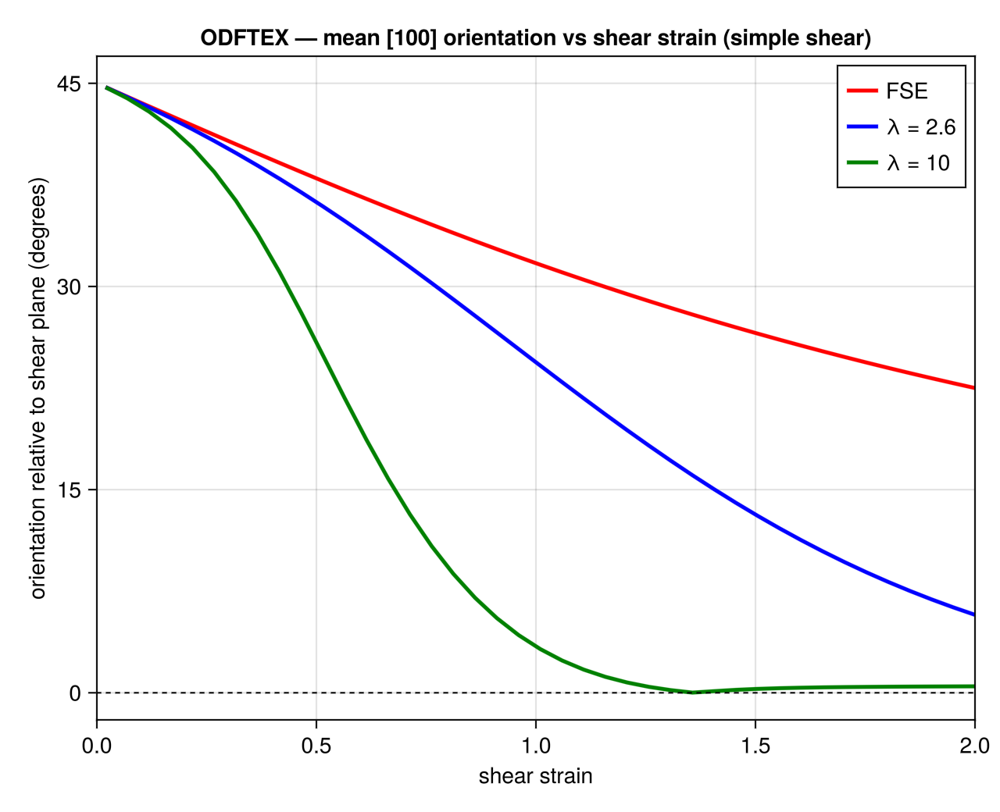

### Figure 7 — Uniaxial compression (`odftex_fig7_uniaxial.jl`)

Olivine pole figures after 58 % uniaxial shortening with λ = 2.6, viewed along the compression axis.

**Compared with the paper:** the pattern matches panel (b) of the paper: a central [010] maximum along the compression axis and girdles of [100] and [001] around it, with the [001] girdle the stronger of the two (1.78 against 1.68 MUD). The texture is somewhat stronger than reported: the M-index is 0.123 at the paper's 12³ resolution, against 0.098 in the paper (and 0.130 for the experiment). At the 90³ resolution used for the figure it is 0.109. As for Figure 5, the M-index estimator may differ from the paper's.

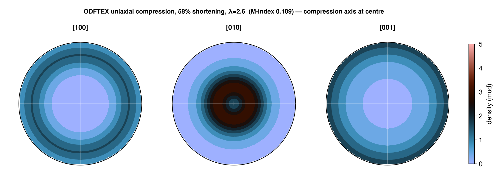

### Figure 8 — Seismic anisotropy in 2-D convection (`odftex_fig8_convection.jl`)

Harzburgite aggregates (olivine:orthopyroxene = 70:30) on a 5 km grid are traced back 20 Myr along the pathlines of two steady convection cells and evolved forward from an isotropic start, once with D-Rex ([`update_all!`](@ref)) and once with ODFTEX ([`odftex_update!`](@ref), 12³ Euler boxes, texture limiter `rmax = 5`). Colours show the radial anisotropy ξ = N/L, white bars the P-wave fast direction scaled by the P-wave anisotropy. The elastic tensor of the ODFTEX aggregates is obtained with [`odf_to_minerals`](@ref) and [`voigt_averages`](@ref).

**Compared with the paper:** the pattern is the same: horizontal fast directions and ξ > 1 along the top and bottom, vertical fast directions and ξ < 1 in the centre and at the sides, and fast directions that follow the streamlines. The agreement between the two models is close to what the paper reports:

| ODFTEX against D-Rex | Paper | DRex.jl |
|---|---|---|
| Mean difference in radial anisotropy ξ | < 0.02 | 0.028 |
| Mean difference in P-wave fast direction | < 10° | 3.1° |
| Mean difference in P-wave anisotropy | < 1 % | 1.6 % |
| Speed-up of ODFTEX | about 6× | 21× (3 min against 62 min on 8 threads) |

The numbers cannot be expected to match exactly, for the two reasons given in the note below.

!!! note
    The paper shows the streamlines but does not give the flow field. The script assumes a sine-product stream function with downwelling in the centre and a peak surface velocity of 5 cm/yr. The D-Rex panel of the paper was computed with D-Rex_M, which differs in detail from the D-Rex implemented here.

```bash
julia --project=. -t auto odftex_fig8_convection.jl                      # full resolution, about an hour
ODFTEX_FIG8_SPACING=20 julia --project=. -t auto odftex_fig8_convection.jl   # quick look, a few minutes
```

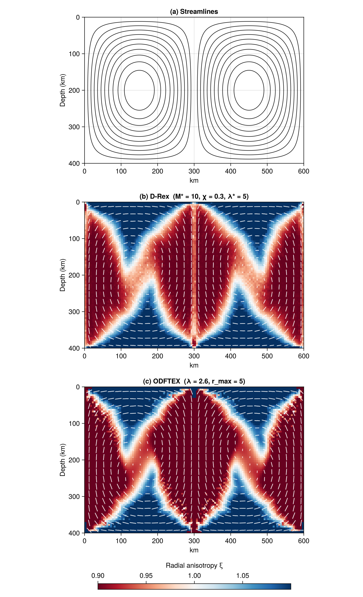

---

## LaMEM 3D subduction (`examples/LaMEM/`)

Post-processes CPO from a full 3D LaMEM subduction simulation. See [LaMEM Integration](@ref) for details.
