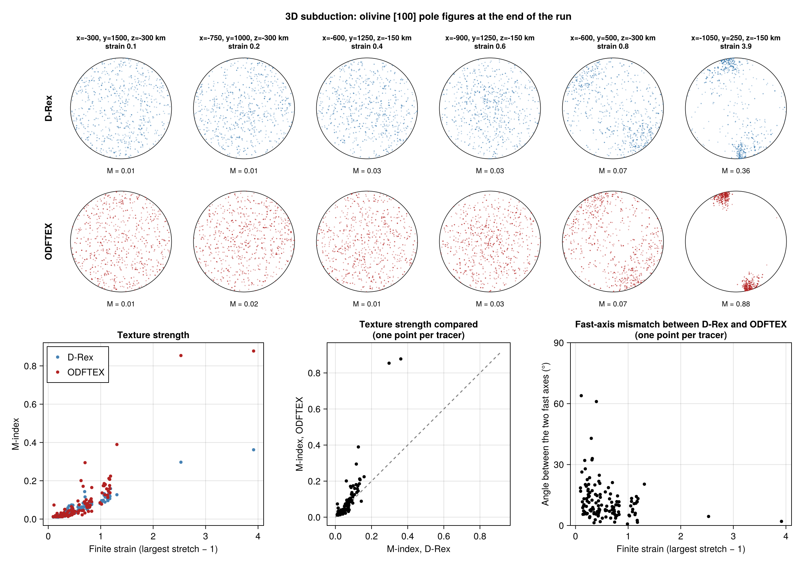
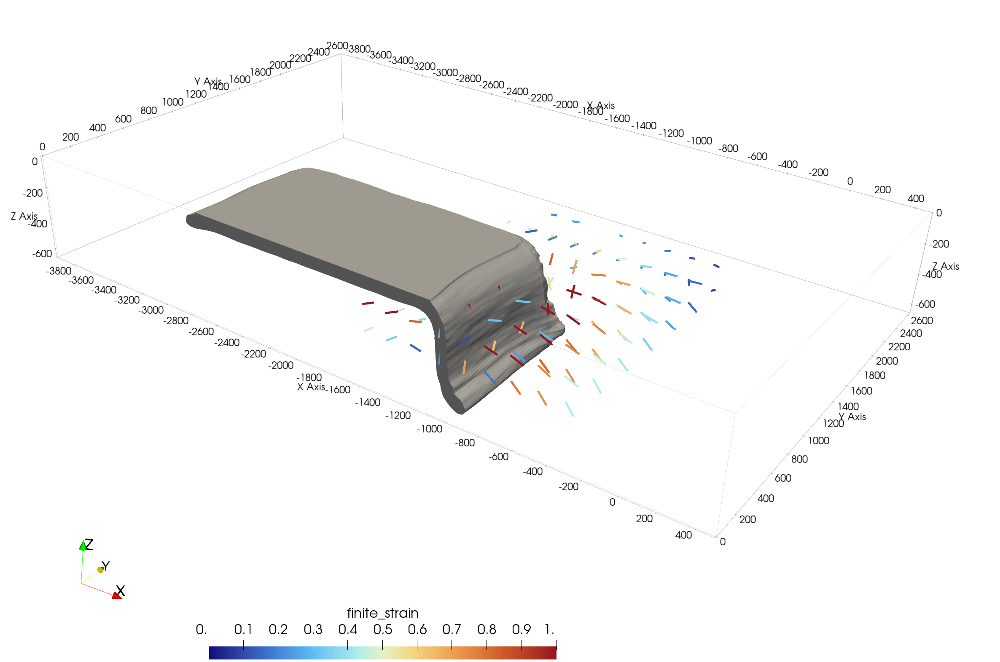

# LaMEM Integration

MantleFabric.jl can be coupled to 3D geodynamic simulations run with
[LaMEM](https://github.com/JuliaGeodynamics/LaMEM.jl) via an **optional package
extension** that loads automatically when the trigger packages are imported:

```julia
using LaMEM, GeophysicalModelGenerator, WriteVTK
using MantleFabric   # MantleFabricLaMEMExt loads automatically
```

## How it works

1. **Load snapshots** — reads all LaMEM output timesteps (velocity gradient tensor and
   optionally velocity) and converts units to km / Myr / (1/Myr).
2. **Backtrack positions** — starting from user-specified target locations at the *final*
   snapshot, positions are advected backward through the velocity field to find the
   material source at the first used snapshot.
3. **Seed tracers** — [`create_tracers`](@ref) places `Mineral` particles with random
   initial orientations at the backtracked source positions.
4. **Evolve CPO** — [`evolve_cpo!`](@ref) advects tracers forward and integrates the D-Rex
   ODE at each step; all tracers run in parallel via `Threads.@threads`.
5. **Write ParaView output** — a `.pvd` time-series and per-step `.vtp` files are
   written with the following point data:

| Field | Type | Description |
|---|---|---|
| `fast_axis` | 3-vector | Bingham-mean olivine a-axis direction |
| `m_index` | scalar | Texture strength (0 = random, 1 = single crystal) |
| `finite_strain` | scalar | Largest principal stretch − 1 |
| `deformation_gradient` | 3×3 tensor | Full deformation gradient **F** |

!!! note "Deformation gradient vs CPO"
    `deformation_gradient` is the *final* accumulated **F** for each tracer (the value
    at the end of the simulation). It is written at every time step in the `.pvd` series
    but does not change between frames — only the CPO fields (`fast_axis`, `m_index`)
    and positions vary per snapshot. **F** and CPO are different quantities: **F**
    describes the bulk macroscopic deformation of a material parcel, whereas CPO
    tracks the orientations of individual grains within it.

## All-in-one function

[`compute_cpo_from_lamem`](@ref) does everything in a single call:

```julia
tracers, snaps = compute_cpo_from_lamem(
    "Subduction_3D_CPO", "Subduction_3D_CPO";
    target_positions   = [[x, y, z], ...],   # or: initial_positions
    output_dir         = "Subduction_3D_CPO_tracers",
    skip_initial_steps = 5,
    drex_params        = drex_params,
    n_grains           = 1000,
    n_substeps         = 5,
    fabric             = olivine_A,
)
```

### Choosing the texture model: D-Rex or ODFTEX

The `method` keyword selects how the texture is evolved on the tracers:

| `method` | Model |
|---|---|
| `:drex` (default) | Discrete D-Rex grains (Kaminski et al. 2004) |
| `:odftex` | Continuous ODF on an Euler-angle grid (Ribe, Faccenda & VanderBeek 2026) |

```julia
tracers, snaps = compute_cpo_from_lamem(
    sim_name, sim_dir;
    target_positions = [...],
    method = :odftex,
    nbox   = 30,     # Euler-grid resolution (nbox³ boxes per tracer)
    λ      = 2.6,    # recrystallisation parameter
)
```

Everything else (positions, backtracking, snapshot window, steady-state mode,
ParaView output) works the same for both. With `:odftex`:

- the D-Rex entries of `drex_params` are not used, apart from `:phase_assemblage`;
- only the olivine A-type slip system is available (`fabric = olivine_A`);
- `n_grains` is the number of orientations sampled from the ODF after every step
  and stored in `tracer.minerals`, so the usual diagnostics and plots apply;
  the ODF itself is in `tracer.odf`;
- the number of texture steps per snapshot interval is set automatically so that
  the strain increment per step stays below 0.025 (`odftex_max_strain_step` in
  [`evolve_cpo!`](@ref)).

The figure below compares the two models on the 3D subduction example, using the
same 126 tracers and the same LaMEM velocity field. The fast-axis directions
agree to within about 10° (median) and texture strength is similar at small
strain; at large strain ODFTEX (λ = 2.6) gives a considerably sharper texture
than D-Rex with the parameters of the example (`gbm_mobility = 10`). It is
produced by
[`examples/LaMEM/compare_drex_odftex.jl`](https://github.com/JuliaGeodynamics/MantleFabric.jl/tree/main/examples/LaMEM).



### Time-dependent vs steady-state mode

**Time-dependent** (default): reads velocity gradients from every snapshot.

**Steady-state**: assumes a single snapshot's velocity field is constant in time,
useful for testing CPO development or avoiding loading hundreds of files:

```julia
tracers, snaps = compute_cpo_from_lamem(
    sim_name, sim_dir;
    target_positions      = [...],
    steady_state_step     = 150,
    steady_state_duration = 20.0,   # Myr
    steady_state_n_steps  = 200,
)
```

### Position specification

Provide exactly one of:

| Keyword | Description |
|---|---|
| `target_positions` | `[x,y,z]` km at the **last snapshot** — positions are backtracked to find the source |
| `initial_positions` | `[x,y,z]` km at the **first snapshot** — CPO is evolved forward directly |

## Lower-level API

```julia
snaps   = load_snapshots(sim_name, sim_dir)
src     = backtrack_positions(target_positions, snaps; n_substeps=5)
tracers = create_tracers(src; n_grains=1000, seed=42, fabric=olivine_A)   # add method=:odftex for ODFTEX
evolve_cpo!(tracers, drex_params, snaps; advect=true, n_substeps=5)
```

## Visualising in ParaView

```
File → Open → <output_dir>/cpo_tracers.pvd
```

Useful filters:
- **Glyph → Arrow** oriented by `fast_axis`, scaled by `m_index` — fast axis direction and strength
- **Threshold** on `m_index` — hide near-random tracers (M < 0.05)
- **Calculator** on `deformation_gradient` — extract individual F components or principal stretches

## Prerequisites

The LaMEM simulation must be run with these output flags in the `.dat` file:

```
out_vel_gr_tensor = 1
out_velocity      = 1
```

See [`examples/LaMEM/`](https://github.com/JuliaGeodynamics/MantleFabric.jl/tree/main/examples/LaMEM) for a complete 3D subduction example.


